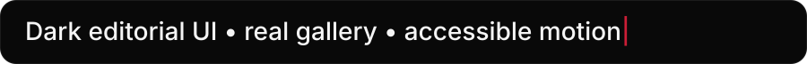
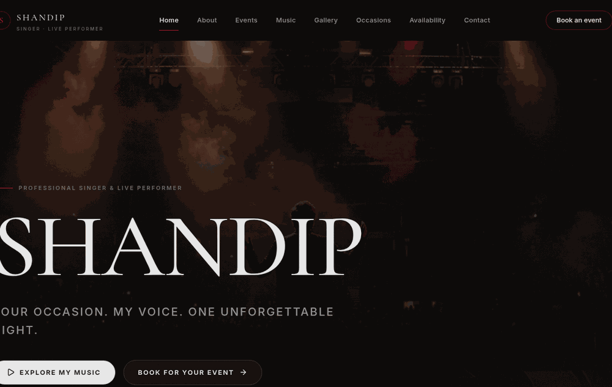
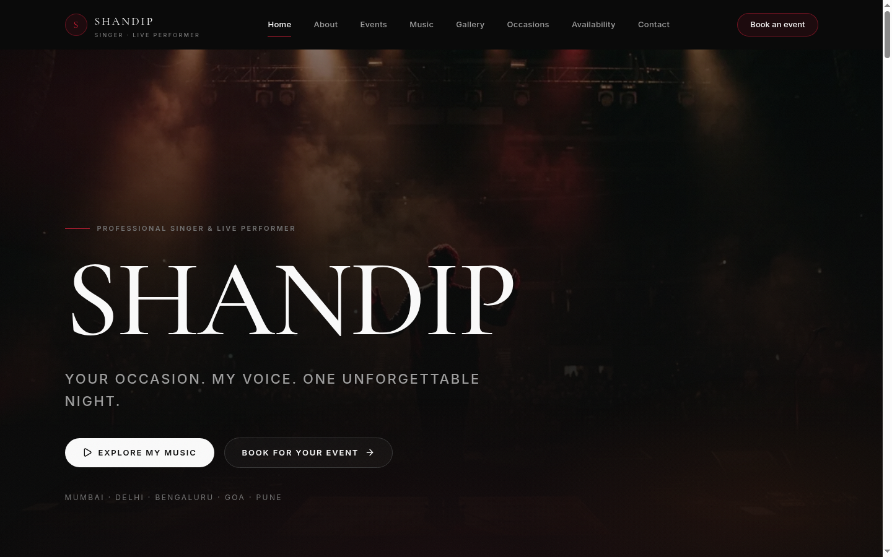
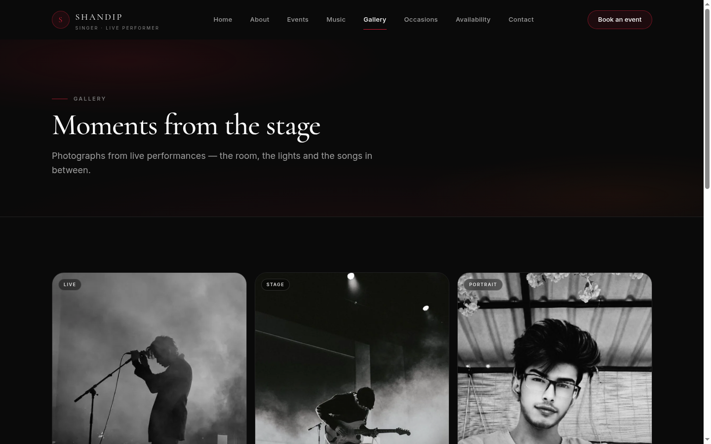
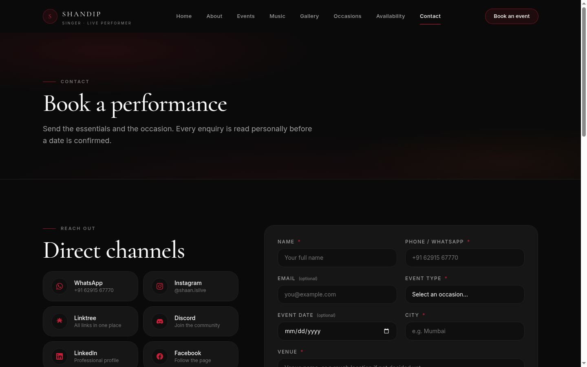

<p align="center">
  
</p>

<h1 align="center">SHANDIP</h1>
<p align="center"><strong>Premium cinematic singer website for a live performer brand.</strong></p>

<p align="center">
  <a href="https://github.com/codeswithshan/shandip-singer-website/actions/workflows/ci.yml">
    
  </a>
  
  
  
  
</p>

<p align="center">
  
</p>

<p align="center">
  Your occasion. My voice. One unforgettable night.
</p>

<p align="center">
  
</p>

## Overview

This repository contains the real codebase for **SHANDIP**, a dark editorial artist website built as a polished React application rather than a static mockup. It focuses on a premium stage aesthetic: almost-black surfaces, restrained deep-red gradients, large serif-led typography, cinematic spacing, subtle motion, and accessible interaction patterns.

The current build includes:

- a multi-route public website
- a homepage with hero, marquee, music, gallery, occasions, availability, enquiry, testimonials and contact sections
- a dedicated `/gallery` route with real performance photography
- real public contact links
- accessible motion with reduced-motion support
- GitHub Actions CI for `pnpm typecheck` and `pnpm test`

> Honest note: GitHub README files cannot run JavaScript, so a truly interactive or 60fps script-driven README is **not possible** on GitHub. This README uses **GitHub-safe animated SVG assets** plus a **real captured demo GIF** from the live site preview.

<p align="center">
  
</p>

<p align="center">
  
</p>

## Features

- **Premium cinematic visual system** with dark editorial styling
- **Responsive multi-page experience** across home, about, events, music, gallery, occasions, availability and contact
- **Real gallery media** using the artist's uploaded performance photos, optimized and served locally
- **Accessible lightbox** with keyboard navigation, focus trapping and mobile-friendly interaction
- **Real contact links** for WhatsApp, phone, email and social platforms
- **Subtle motion language** based on transform/opacity only
- **Reduced-motion path** for users who prefer less animation
- **Minimal GitHub Actions CI** that validates type safety and tests on every push and pull request

## Tech Stack

| Layer | Choice |
|---|---|
| UI | React 19 |
| Language | TypeScript |
| Styling | Tailwind CSS v4 |
| Build Tool | Vite |
| Routing | wouter |
| Testing | Vitest |
| Icons | lucide-react + inline SVG brand glyphs |
| CI | GitHub Actions |

## Screenshots / Gallery

All screenshots below are **real captures from the actual running site**, taken from the sandbox preview during this update.

### Home hero



### Gallery route



### Contact route



<p align="center">
  
</p>

## Getting Started

### Install

```bash
pnpm install --frozen-lockfile
```

### Run locally

```bash
pnpm dev
```

### Build

```bash
pnpm build
```

### Typecheck

```bash
pnpm typecheck
```

### Test

```bash
pnpm test
```

## Project Structure

```text
client/
  public/
    images/
      gallery/              optimized local WebP gallery images
  src/
    components/             reusable UI building blocks
    data/                   site content and structured page data
    lib/                    utilities
    pages/                  route-level page components
    index.css               design tokens, layout rules and motion system
server/                     scaffold server code (public site currently frontend-led)
shared/                     shared types and constants
docs/                       README assets (screenshots, animated SVGs, demo GIF)
.github/workflows/          CI workflow
```

## Routes

| Route | Purpose |
|---|---|
| `/` | Homepage with hero, marquee, music, gallery, occasions, availability, enquiry, testimonials and contact |
| `/about` | Artist introduction |
| `/events` | Events page |
| `/music` | Music section and listening links |
| `/gallery` | Dedicated gallery route with lightbox |
| `/occasions` | Occasion and performance offerings |
| `/availability` | Availability calendar |
| `/contact` | Contact details and enquiry form |

## Design System

The visual language is intentionally restrained and premium:

- **Base:** almost-black backgrounds
- **Accent:** subtle dark-red gradients rather than bright saturated red
- **Typography:** editorial serif display paired with clean sans-serif body text
- **Spacing:** generous vertical rhythm and breathing room
- **Glass:** used lightly, only where it improves depth
- **Motion:** transform/opacity-only transitions with a full `prefers-reduced-motion` path
- **Accessibility:** descriptive labels, keyboard support, focus visibility and honest content treatment

## CI

The repository includes a minimal GitHub Actions workflow at:

```text
.github/workflows/ci.yml
```

It runs on:

- every `push`
- every `pull_request`

Checks performed:

- `pnpm install --frozen-lockfile`
- `pnpm typecheck`
- `pnpm test`

## Contact

These are the real public contact channels currently wired into the site:

- **WhatsApp:** https://wa.me/916291567770
- **Phone:** `+91 9365395136`
- **Email:** `shandip8638@gmail.com`
- **Instagram:** https://instagram.com/shaan.islive/
- **Linktree:** https://linktr.ee/winewithshan
- **Discord:** https://discord.gg/kMANJukS7
- **LinkedIn:** https://www.linkedin.com/in/shandip-das-834410417
- **Facebook:** https://www.facebook.com/share/14qmhb5r3UX/

## License

No license file is currently included in this repository.

If you want to open-source reuse beyond normal GitHub visibility, add an explicit `LICENSE` file first.
